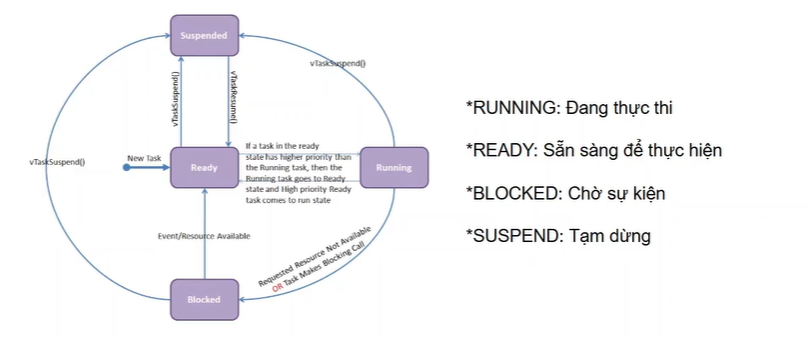
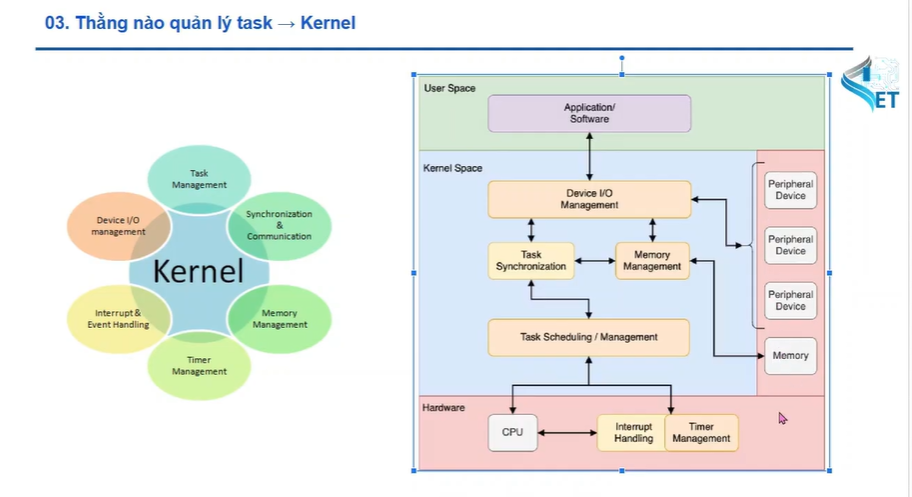
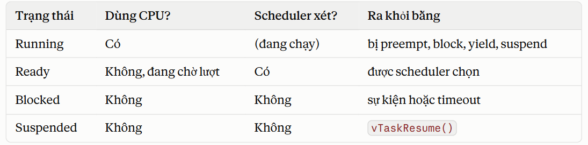
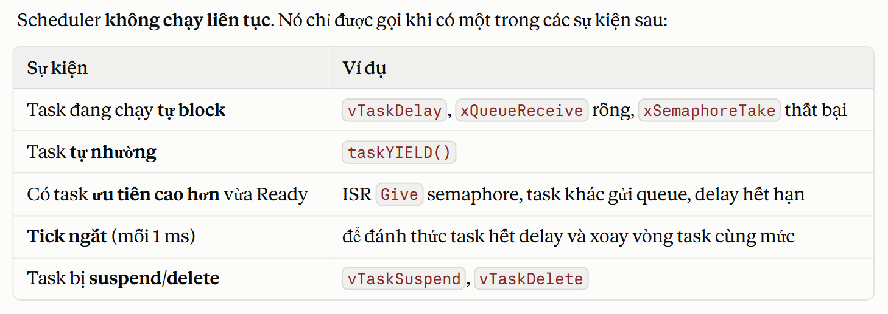
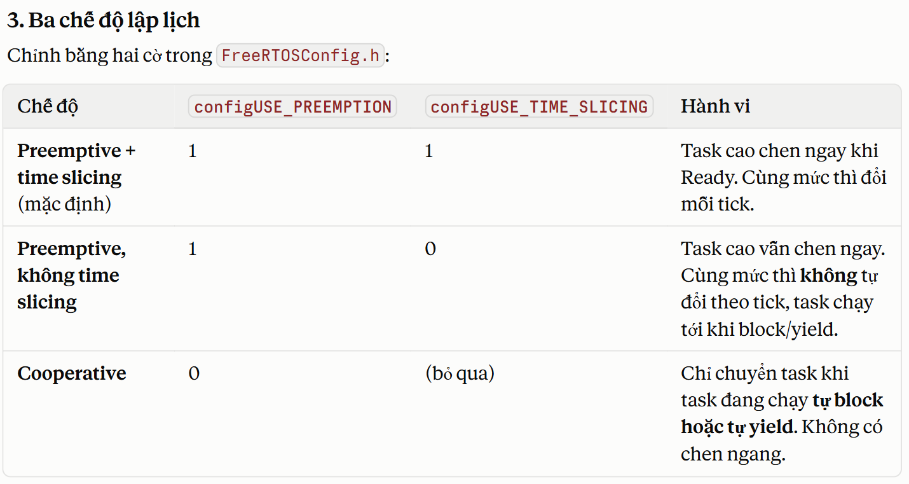
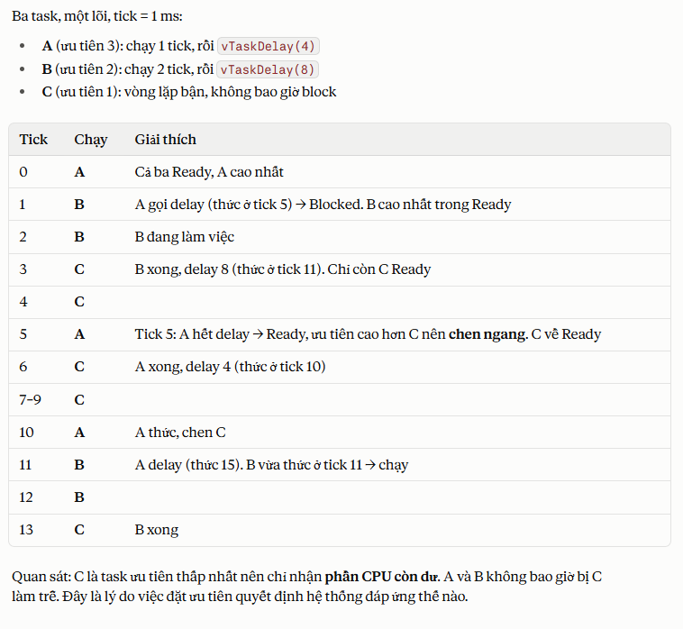

# 1. FreeRTOS là cái gì
- cho phép chia trương chình thảnh nhiều task độc lập. mỗi task trông như 1 while(1) riêng, còn scheduler quyết định task nào chạy tại 1 thời điểm

- stm32 chỉ có  core nên chỉ chạy được 1 task trong 1 thời gian, để khắc phục người ta sẽ để các task chạy luân phiên nhau trong 1 thời gian rất nhỏ khiến ta nghĩ là các task chạy song song

# 2. các khái niểm cốt lõi
- task : một hàm chạy vô hạn, có stack riêng, có độ ưu tiên riêng
- scheduler : bộ lập lịch. Mặc định là preemptive: task có ưu tiên cao hơn sẽ chiếm CPU ngay khi sẵn sàng. Các task cùng ưu tiên chia sẻ thời gian theo vòng (round-robin).
- Tick: ngắt định kỳ (thường 1 ms) để scheduler đo thời gian và chuyển task. Trên STM32 dùng SysTick.
- Trạng thái task: Running, Ready, Blocked (đang chờ delay/queue/semaphore), Suspended.
    - running : là đang thực thi
    - ready : sẵn sang để thực hiện, chưa được cpu cấp phép, chỉ cần 1 hàm gọi
    - block : tạm dùng tạm thời, cần 1 sự kiện nào đó để chạy
    - suspend : hệ thống tạm dùng luôn, cần 1 function nào đó để kích hoạt lại
    
- Blocking: task gọi vTaskDelay() hoặc chờ queue sẽ nhường CPU cho task khác. Đây là điểm mạnh nhất của RTOS: không bao giờ dùng vòng lặp chờ bận (busy-wait).


# 3. kernel
- cái để quản lý các task, quản lí mọi thứ
- lấy tài nguyên cho task nào chạy là do kernel



# 4. 4 trạng thái của task
- cách kernel nghĩ về mọi task
```
                    ┌──────────────────────────────┐
                    │          SUSPENDED           │
                    └───────▲──────────────┬───────┘
          vTaskSuspend()    │              │  vTaskResume()
        (từ bất kỳ trạng    │              │  (về Ready)
         thái nào)          │              ▼
   ┌────────────┐  scheduler chọn  ┌───────────┐
   │   READY    │ ───────────────► │  RUNNING  │
   │            │ ◄─────────────── │           │
   └─────▲──────┘  bị preempt /    └─────┬─────┘
         │         hết time slice /      │
         │         taskYIELD()           │ vTaskDelay(), xQueueReceive(),
         │                               │ xSemaphoreTake(),
         │  sự kiện xảy ra               │ ulTaskNotifyTake()...
         │  hoặc hết timeout             ▼
         │                         ┌───────────┐
         └──────────────────────── │  BLOCKED  │
                                   └───────────┘
```

1. Running (đang chạy)
- Task đang thực sự chiếm CPU. Trên chip một lõi như STM32F1/F4, tại mỗi thời điểm chỉ có đúng một task ở trạng thái này.
- Kernel nhớ nó qua biến pxCurrentTCB.
- Task rời Running khi: bị task ưu tiên cao hơn chen vào (preempt), hết time slice (round-robin), tự gọi hàm block, tự taskYIELD(), hoặc bị suspend.


2. Ready (sẵn sàng)
- Task đủ điều kiện chạy nhưng đang chờ tới lượt vì CPU đang bận với task khác (ưu tiên cao hơn hoặc bằng).
- Nằm trong pxReadyTasksLists[priority], mỗi mức ưu tiên một list.
- Scheduler luôn chọn task ở list có ưu tiên cao nhất còn task. Nếu nhiều task cùng mức, chúng luân phiên.
- Task mới tạo bằng xTaskCreate bắt đầu ở trạng thái này.

3. Blocked (bị chặn, đang chờ)

- Task đang chờ một sự kiện, nên không cần CPU. Có hai loại sự kiện:

   - Thời gian: vTaskDelay(), vTaskDelayUntil().
   - Đồng bộ: dữ liệu đến queue, semaphore/mutex được nhả, notification, event group bit.

- Điểm quan trọng nhất: Blocked có timeout. Khi gọi xQueueReceive(q, &x, pdMS_TO_TICKS(100)), task sẽ về Ready khi có dữ liệu hoặc sau 100 ms, tùy cái nào đến trước. Nếu timeout là portMAX_DELAY thì chờ vô hạn (nội bộ nằm trong Suspended list nếu INCLUDE_vTaskSuspend = 1).

- Task Blocked không tốn CPU và không bao giờ được scheduler xét đến. Đây là lý do viết task kiểu “chờ sự kiện rồi mới làm” hiệu quả hơn nhiều so với polling.

4. Suspended (bị treo)
- Task bị loại khỏi scheduler hoàn toàn, không có timeout, không tự thức dậy.
- Chỉ ra khỏi trạng thái này khi có ai đó gọi vTaskResume(handle) (hoặc xTaskResumeFromISR trong ngắt).
- Vào bằng vTaskSuspend(handle). Truyền NULL để tự treo chính mình.
- Dùng ít trong thực tế. Thường dùng để tạm dừng một task khi debug hoặc khi tắt một chức năng.




# 5. scheduling (cơ chế lập lịch queue)

- mõi tasj có 1 mức ưu tiên(priority), task nào có mức ưu tiên cao nhất thì task đấy sẽ chạy, nếu có 1 task mới có mức ưu tiên hơn task đang chạy thì rtos sẽ tạm hoãn task đang chạy và chạy task kia.


- nếu các task cùng độ ưu tiên thì chúng sẽ chia cpu theo vòng





- Preemption: chen ngang

    - Preemption nghĩa là task đang Running bị lấy CPU đi mà không được hỏi, vì có task ưu tiên cao hơn vừa Ready. Task bị chen không chuyển sang Blocked, nó về Ready và sẽ chạy tiếp từ đúng lệnh bị cắt khi tới lượt.

   - Điều này có hệ quả quan trọng: code của task có thể bị ngắt ở giữa bất kỳ lệnh nào. Vì vậy biến dùng chung giữa các task cần mutex hoặc critical section, kể cả một phép counter++ (đọc-sửa-ghi gồm 3 lệnh).


- Time slicing: chia sẻ cùng mức ưu tiên

    - Giả sử hai task A và B cùng ưu tiên 1, cả hai chạy vòng lặp không bao giờ block. Mỗi lần tick xảy ra, kernel thấy Ready list mức 1 có hơn một task, nên yêu cầu chuyển task. Kết quả:


    - Mỗi task được một time slice = 1 tick. Nếu A block giữa chừng (ví dụ gọi delay ở giữa tick), B được chạy ngay và tick kế tiếp không đảm bảo B bị ngắt đúng sau 1 tick tròn. Slice bị cắt ngắn là chuyện bình thường.
   - nếu số ưu tiên bằng nhau thì thường là task nào được tạo trước thì chạy trước, nhưng vẫn là do con trỏ pxIndex quyết định tuỳ phiên bản

- Ví dụ trace từng tick



