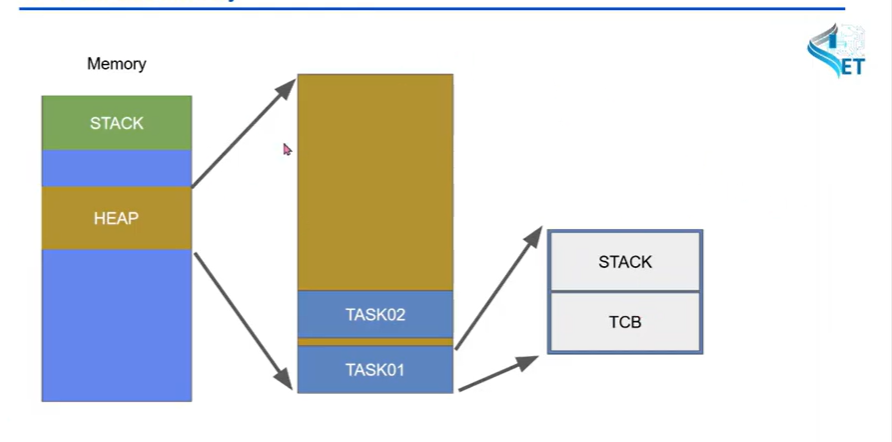
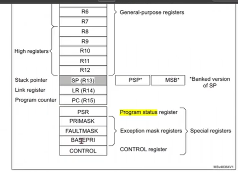
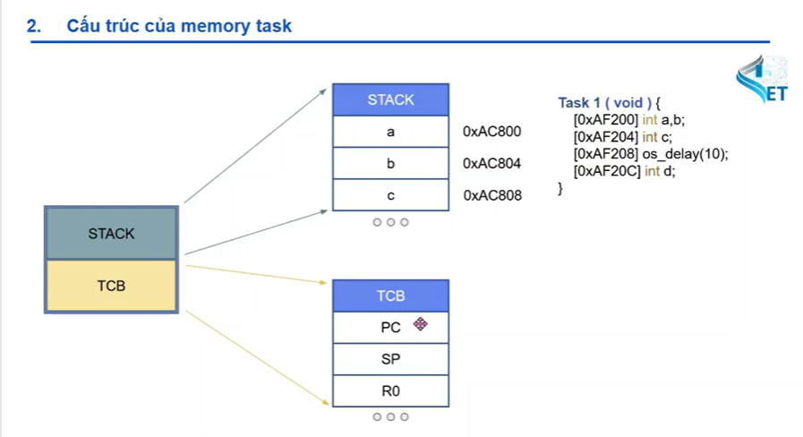
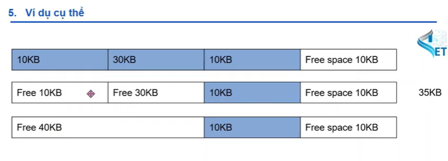

# 1. phân chia memory

- chủ yếu nằm trong phân vùng heap
- chia thành nhiều task
- trong mỗi task có :

     - stack : chứa địa chỉ các biến, vân vân..
     - TCB : lưu chữ các thanh ghi ví dụ như sp(lưu trữ địa chỉ đầu của stack), pc(thanh ghi lưu chữ địa chỉ của lệnh tiếp theo đối với arm cortex m3), r0, r1, ....
    

   

# 2. cách quản lí heap của rtos

- heap1 : không cho phép giải phóng bộ nhớ. tạo 1 task ngay khi khởi động chạy liền tù tì và k giải phóng task
- heap 2 : cho phép giải phóng bộ nhớ, nhưng k thay đổi các vùng nhớ ban đầu hay k gộp được các vùng nhớ vào nhau
- heap 3 : dùng code c malloc() và free() để cấp phát và giải phóng bộ nhớ. vòng free space sau khi giải phóng bộ nhớ sẽ gây ra hiện tượng phân mảnh bộ nhớ

- heap 4 : có thể giải phóng bộ nhớ và gộp các vùng nhớ lại với nhau sau khi giải phóng, giải quyết được phân mảnh bộ nhớ. chỉ sử dụng memory nội

- heap 5 : y hệt heap 4 nhưng sử dụng được memory ngoại, quản lý nhiều vùng ram khác nhau như sram, pram

