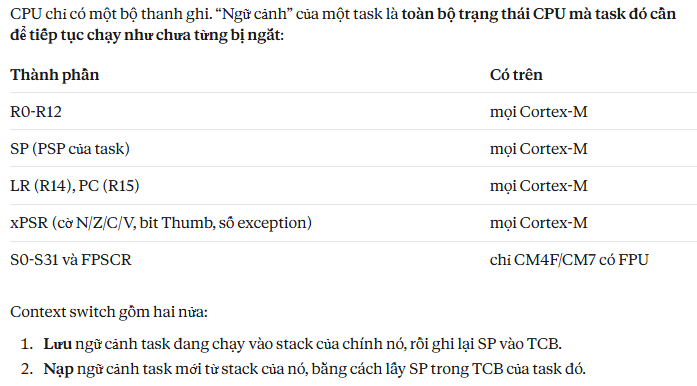
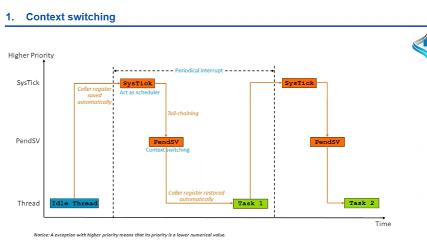
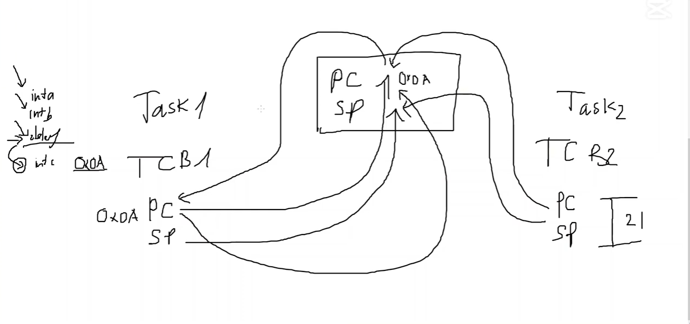
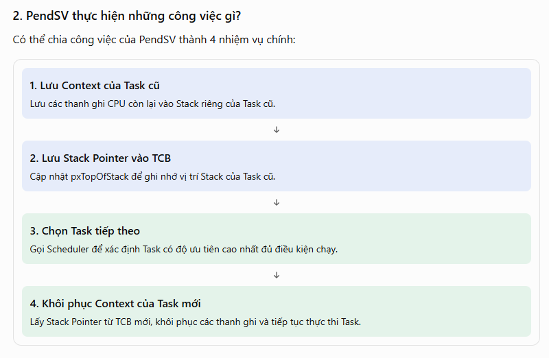

# 1. context switching (chuyển đổi ngữ cảnh)
- là quá trình mà cpu chuyển từ thực thi tiến trình này sang tiến trình khác, quá trình chuyển từ task này sang task khác

scheduler : quyết định task nào được chạy tiếp theo

- systick thì là bộ đếm thời gian, quyết định xem có cần thực hiện context switch hay k

- PendSV là ngắt phần mềm, là một loại exception đặc biệt trên vi điều khiển lỗi arm, được thiết kế hỗ trợ context switching giúp chuyển đổi giữa các task hiệu quả hơn

--> nói chung systick và scheduler ra quyết định còn PendSV là người thực hiện
# 2. quá trình lưu thông tin và lấy lại thông tin của pendsv

-  trên arm cotexM thì freertos dùng thanh ghi hệ thống ICSR để yêu cầu pendSV

- khi quá trình context switching xảy ra thì các thanh ghi của task cũ sẽ được lưu vào stack riêng của task đó

- đồng thời lưu địa chỉ đỉnh SP vào TCB của task đó (ví dụ : pxTopOfStack)

- khi khôi phục lại task thì cpu lấy địa chỉ đỉnh SP ra từ TCB và tiếp tục thực hiện lệnh tiếp theo

- pendSV có mức ưu tiên thấp nhất, ví dụ như sau ngắt uart, ngắt timer

# 3. pendsv làm gì và làm như nào

- 