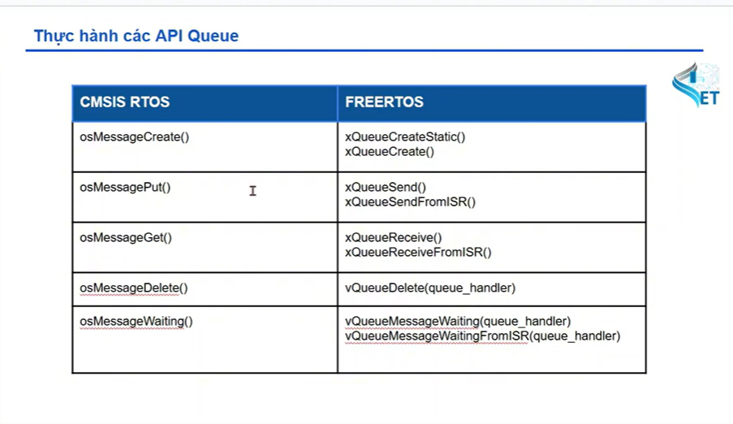
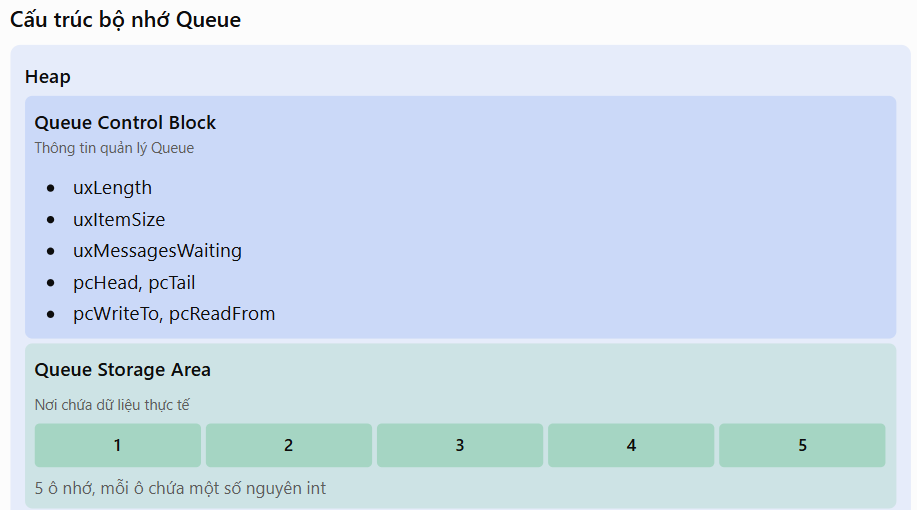

# 1. queue
- được sử dụng để các task trao đổi tài nguyên với nhau
- FIFO : first in first out
- chứa dữ liệu 
- kích thước và số ô dữ liệu được khởi tạo sẵn cố định

- có 2 dạng :
   - messagr queue : truyền dữ liệu dạng đơn
   - mail queue : truyền dữ liệu dạng khối

- khi khởi tạo queue thì nó sẽ đc rtos cấp phát bộ nhớ từ heap gồm 2 phần là :
  - queue control bolock : lưu thông tin quản lý queue
  - queue storage area : vùng nhớ chứa dữ liệu thực tế được gửi vào 

- khi queue đầy thì có 3 trường hợp:
    - ko chờ và trả về ngay :
         - Không ghi được dữ liệu mới.
         - Hàm trả về errQUEUE_FULL.
         - Task tiếp tục chạy, không bị Block
    - chờ 1 khoảng thời gian :
         - Task gửi chuyển sang trạng thái Blocked.
        - Task chờ tối đa 1000 ms để Queue có chỗ trống.
        - Nếu Task khác lấy dữ liệu ra trước khi hết thời gian, Task gửi có thể được đánh thức và gửi dữ liệu.
    - chờ vô hạn :
        - Task gửi chuyển sang Blocked.
        - Chờ đến khi có chỗ trống mới tiếp tục.
        - Điều này chỉ thực sự là chờ vô thời hạn khi cấu hình INCLUDE_vTaskSuspend = 1.
        - Nếu hết 1000 ms mà Queue vẫn đầy, hàm trả về errQUEUE_FULL.
    
    (thực tế thường rơi vào trường hợp 2 với 3)

- queue có một kích thước phần tử cố định, có thể dùng struct hoặc union để đóng gói dữ liệu khác nhau

- nếu queue rỗng thì trả về errqueue_empty hoặc chuyển task sang block nếu có timeout hoặc chờ mãi nếu có max_delay 

# 2. message queue 

- khi task trong thời gian timeout để đợi dữ liệu trong queue thì task đó ở trạng thái block

- quy tắc chọn khi nhiều task cùng chờ : 
  - tash ưu tiên cao hơn  thì được phục vụ trước
  - nếu cùng ưu tiên task chờ lâu hơn thì được phục vụ trước

