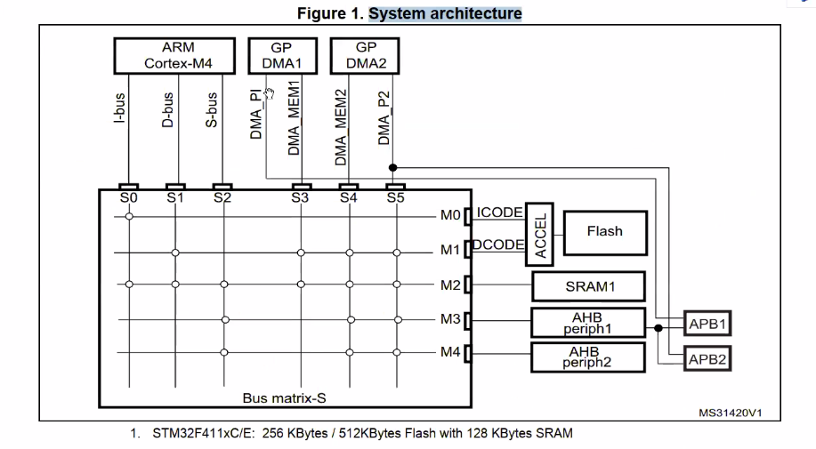
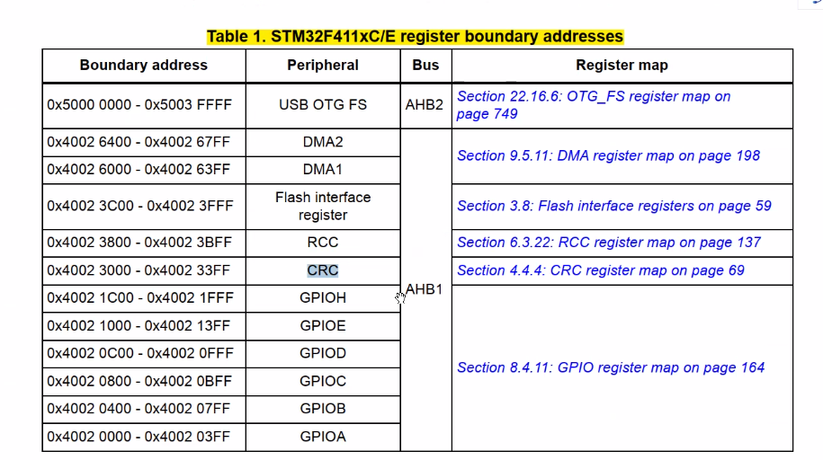

# 1. đọc tài liệu
arm cortex m4

4 file tài liệu reference,....

bus matrix của f4 (cấu trúc bus, có những bus nào, kiểu kết nối...) :

- chia thành master với slave
- có 2 bus AHB

- i-bus chuyển hoá giao tiếp giữa core với phần bên trong
- d-bus là l...
- s-bus ...
- dma bộ nhớ bus....

địa chỉ thanh ghi map :

# 2. GPIO

